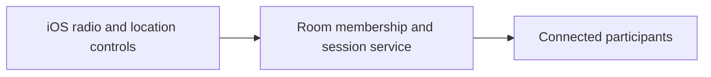

# WRU Radio

## Architecture

An iPhone app for private radio-style communication and voluntary location sharing.

### Follow one interaction

Join a room, choose when to transmit and use the radio controls to communicate with the other members. Location is a separate interaction with its own device permissions.

## APIs and interfaces

| Connection | What crosses it |
| --- | --- |
| iPhone → radio service | The client sends authenticated requests for room and session state. Device permissions govern microphone and location use. |
| Service → device | Apple Push Notification service (APNs) supports background notifications. A notification is a signal for the client; it is not a permanent copy of the whole room. |

### Why it works this way

Room membership defines who can participate. Audio and location have different permission and delivery requirements, so the app handles them separately.

## Source in this repository

Read [location-quality.mjs](location-quality.mjs) to see how a room checks the age and accuracy of a location update before using it. This is an excerpt from the original app.

[Back to the project index](https://github.com/IT-Yun/IT-Yun)
